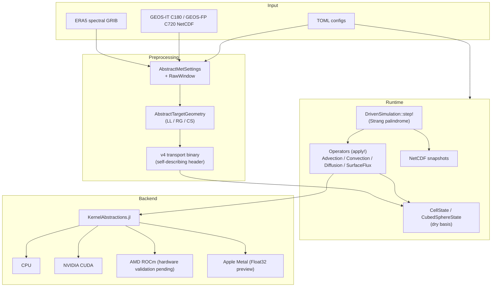

# AtmosTransport.jl

<!-- Build, documentation, and package information -->
[](https://github.com/RemoteSensingTools/AtmosTransport.jl/actions/workflows/CI.yml?query=branch%3Amain)
[](https://RemoteSensingTools.github.io/AtmosTransport.jl/stable/)
[](https://RemoteSensingTools.github.io/AtmosTransport.jl/dev/)
[](LICENSE)
[](Project.toml)

<!-- Testing, coverage, and performance -->
[](https://github.com/JuliaTesting/Aqua.jl)
[](https://codecov.io/gh/RemoteSensingTools/AtmosTransport.jl)
[](https://remotesensingtools.github.io/AtmosTransport.jl/benchmarks/)

> **Actively developed research software.** Supported CPU and NVIDIA CUDA
> workflows have regression tests and documented numerical checks. Interfaces
> and numerical results can change between releases; pin a version for
> reproducible experiments and read the [release notes](CHANGELOG.md) before
> upgrading. Broader Metal coverage and some inversion workflows still have
> validation gaps, described in the status tables below.

A Julia-based, GPU-portable atmospheric tracer transport model for offline
chemistry / chemical-transport applications. Designed for **mass-conserving**
advection, convection, and boundary-layer diffusion on **lat-lon, reduced
Gaussian, and cubed-sphere** grids, driven by **ERA5** or **GEOS** met data,
with a clean separation between offline preprocessing and runtime stepping.

## Quick start

The fastest way to get a real simulation running:

```bash
# 1. Clone + install
git clone https://github.com/RemoteSensingTools/AtmosTransport.jl.git
cd AtmosTransport.jl
julia --project=. -e 'using Pkg; Pkg.instantiate()'

# 2. Generate a small current-format binary and run it
julia --project=. examples/generate_synthetic_quickstart.jl
julia --project=. scripts/run_transport.jl config/examples/minimal_template.toml
```

The result is `data/quickstart/synthetic_output.nc`. No external meteorology,
account, or GPU is required. Production configs use
`$ATMOSTRANSPORT_DATA_ROOT/...`, which defaults to `~/data/AtmosTransport`
when unset.

## Documentation

The [stable manual](https://RemoteSensingTools.github.io/AtmosTransport.jl/stable/)
describes the latest release. Use the
[development manual](https://RemoteSensingTools.github.io/AtmosTransport.jl/dev/)
when working from `main`, or select a version in the manual for older releases.
The reading order:

1. **[Start Here](https://RemoteSensingTools.github.io/AtmosTransport.jl/stable/getting_started/installation)** — installation, Julia orientation, zero-download quickstart, real meteorology, and output inspection.
2. **[Architecture tour](https://RemoteSensingTools.github.io/AtmosTransport.jl/stable/concepts/architecture)** — the binary-to-model pipeline and source map.
3. **[User Guide](https://RemoteSensingTools.github.io/AtmosTransport.jl/stable/concepts/grids)** — grids, state and basis, operators, and the binary contract.
4. **[Workflows](https://RemoteSensingTools.github.io/AtmosTransport.jl/stable/config/toml_schema)** — runtime configuration and meteorology preprocessing.
5. **[Examples](https://RemoteSensingTools.github.io/AtmosTransport.jl/stable/tutorials/_generated/synthetic_latlon)** — executable, Literate-driven tutorials.
6. **[Theory & Validation](https://RemoteSensingTools.github.io/AtmosTransport.jl/stable/theory/mass_conservation)** — conservation, numerics, evidence, and known gaps.
7. **[Learn adjoints](https://RemoteSensingTools.github.io/AtmosTransport.jl/stable/getting_started/adjoints)** — a checked emission footprint, then a synthetic inversion with explained observations, controls and priors.
8. **[API Reference](https://RemoteSensingTools.github.io/AtmosTransport.jl/stable/api/)** — the curated public API and per-module docstrings.

## Features

Feature labels summarize the detailed [validation status](#status-tracker):
**stable** means production-used and regression-tested; **preview / experimental**
means implemented but still missing campaign validation or complete backend
coverage.

- **Stable: lat-lon and cubed-sphere; preview / experimental: reduced
  Gaussian — Multi-grid.** Regular lat-lon, reduced Gaussian, and cubed-sphere
  (gnomonic and GEOS-native panel conventions), with a hybrid σ-pressure
  vertical coordinate.
- **Stable: ERA5 and GEOS-IT; preview / experimental: GEOS-FP and MERRA-2 —
  Multi-source.** ERA5 spectral preprocessing (LL / RG / CS targets) and
  native cubed-sphere preprocessing for GEOS-IT C180 and GEOS-FP C720, plus a
  MERRA-2 wind-derived CS path (with convection and PBL inputs from the
  GEOS-Chem MERRA-2 archive). MERRA-2 data must currently be staged outside
  the unified downloader.
- **Stable: CPU and NVIDIA CUDA; preview / experimental: AMD ROCm and Apple Metal —
  Multi-backend.** Single codebase for CPU and GPU via
  [KernelAbstractions.jl](https://github.com/JuliaGPU/KernelAbstractions.jl).
  CUDA path is end-to-end through the runtime driver; an Apple Silicon /
  Metal weakdep extension exists. AMD ROCm supports Float32/Float64 through
  AMDGPU.jl; hardware validation is pending ([runbook](docs/src/development/rocm.md)).
- **Stable — Mass-conserving.** Dry-basis air-mass bookkeeping, with **write-time
  replay gates** enabled by default in the preprocessor and **opt-in load-time
  replay validation** at runtime. Per-cell tolerances are `1e-12` (F64) /
  `1e-5` (F32), relative to the summed magnitudes of that cell's budget terms.
  The gates certify that the stored fluxes and air masses are consistent, not
  that the winds are right; for that, every newly written binary carries a typed
  flux-fidelity certificate: wind-bearing paths independently reconstruct
  deterministic face samples from `u`, `v`, and `dp`, and paths with source
  OMEGA compare it with the stored vertical mass flux (NRMSE below that of a
  zero vertical flux, correlation > 0.5, positive slope). Native GEOS fluxes
  and payload-only paths carry an explicit typed not-applicable reason; no
  certificate can catch errors in the input fields themselves.
- **Stable — Operator-modular.** Every physics operator is behind an abstract type
  with a `No<Operator>` no-op default; swap schemes via type dispatch
  without modifying core code.
- **Stable — Advection schemes.** `UpwindScheme` (1st order), `SlopesScheme`
  (Russell-Lerner flux with van Leer slopes re-diagnosed every sweep, 2nd
  order in smooth regions; not TM5's prognostic-moment scheme),
  `PPMScheme` (limited Colella–Woodward edges feeding a Russell–Lerner flux,
  2nd order in smooth regions),
  `LinRoodPPMScheme{ORD}` for cubed-sphere with FV3 cross-term advection
  (`ORD ∈ {5, 7}` selects the boundary stencil).
- **Stable — Convection.** `CMFMCConvection` (GCHP-style RAS / Grell-Freitas, for
  GEOS sources) and `TM5Convection` (TM5 four-field entrainment /
  detrainment, for ERA5 sources) — different physics, identical
  `ConvectionForcing` plumbing.

> **Preview / experimental — adjoint and inversion.** The cubed-sphere discrete-adjoint and
> surface-flux 4D-Var stack ship for the supported advection/operator matrix,
> with checkpointing, covariance preconditioning, and optimization drivers.
> Coverage is not universal: the optimized/clamped convection variants and
> TM5-4DVAR cross-validation remain open, and observations are bound to
> column means whatever their altitude. The 4D-Var gradient takes one adjoint
> run for all observations. See
> [Adjoint status](https://RemoteSensingTools.github.io/AtmosTransport.jl/stable/theory/adjoint_status)
> for details.

## Architecture

The source map is in [`src/README.md`](src/README.md). Core mass-budget and
conservation checks live in [`src/Diagnostics/`](src/Diagnostics/README.md).
Non-core Visualization, Analysis post-processing and DataDownloads live in
[`src/Extras/`](src/Extras/README.md) with their existing module names; these
folders have no tests and are intended to become separate packages. Core code
never imports Extras. The optional Makie extension remains in `ext/`.



### Column-Mean CO₂ Transport (ERA5 + EDGAR, GPU)

One-month forward simulation (June 2024) of anthropogenic CO₂ transport on a
1° × 1° × 137-level grid, driven by ERA5 model-level spectral winds and
[EDGAR v8.0](https://edgar.jrc.ec.europa.eu/) surface emissions. The diagnostic
uses the column-averaged mixing ratio enhancement (ppm,
delta-pressure weighted) in Robinson projection.

**Simulation details.** Mass fluxes are pre-computed from ERA5 hybrid-level
vorticity / divergence / log-PS spectral fields following TM5's continuity-
consistent approach (Holton synthesis): horizontal mass fluxes are derived
from the spectral fields, and vertical fluxes are diagnosed from horizontal
convergence to guarantee column mass conservation. Transport uses Strang-split
mass-flux slopes advection (the Russell-Lerner flux with minmod slopes
re-diagnosed every sweep, not TM5's prognostic slopes) and boundary-layer
diffusion (implicit Thomas solver). Transport, diffusion, source
injection and air-mass bookkeeping run on a single NVIDIA L40S GPU via
[KernelAbstractions.jl](https://github.com/JuliaGPU/KernelAbstractions.jl)
in Float32 arithmetic. The current output path uses Float64 accumulation for
column and global mass diagnostics, independently of transport precision.

## Status tracker

Single source of truth for what is production-ready, what is preview /
experimental, and what is planned. Reviewed `2026-10-11`. Items move out
of "experimental" only after a passing CPU+GPU regression suite and a
documented validation run.

### Legend

| Symbol | Meaning |
| :---: | --- |
| ✅ | **Stable.** Used in production runs; CPU+GPU regression-tested; covered by docs. |
| 🟡 | **Preview.** Implementation complete and tested in isolation; not yet validated on a multi-day campaign. Expect rough edges. |
| 🧪 | **Experimental.** Wired in but the contract is not stable; API may move; treat output as research-only. |
| 📐 | **Planned.** Scoped in a plan / memo; not yet implemented. |
| ❌ | **Not supported.** Out of scope today; no current path to "yes". |

### Grids and topology

| Capability | Status | Notes |
| --- | :---: | --- |
| Lat-Lon (structured) | ✅ | Full operator suite, multi-tracer fused kernels |
| Reduced Gaussian (face-indexed) | 🟡 | ERA5 spectral path with the column Poisson balance on the ring graph; CPU-tested, no production campaign. Binaries written before the column balance (header `horizontal_balance = "per_layer"`) carry almost no vertical mass flux: regenerate them |
| Cubed-sphere (gnomonic) | ✅ | Six-panel split-sweep + Lin-Rood ORD=5/7 |
| Cubed-sphere (GEOS-native) | ✅ | Panel-5 rotation, GEOS-IT C180 validated |
| Hybrid σ-pressure vertical | ✅ | TOA at k=1, surface at k=Nz |

### Met sources and preprocessing

| Capability | Status | Notes |
| --- | :---: | --- |
| ERA5 spectral → LL / RG / CS | ✅ | CDS API; `pin_global_mean_ps!` enabled |
| GEOS-IT native → CS (C180) | ✅ | Adaptive substep schedule per window |
| GEOS-FP native → CS (C720) | 🟡 | Native hourly reader and unified preprocessor ship; production validation remains limited |
| MERRA-2 native → CS | 🟡 | Wind-derived CS preprocessor ships (any Nc, L72); CMFMC/DTRAIN and PBL/VDIFF fields from the GEOS-Chem MERRA-2 archive; unified OPeNDAP download execution remains unavailable |
| LL → CS conservative regrid | 🟡 | Works; separate regrid entry point |
| Compressed binaries at rest (zstd) | ✅ | User-side; runtime always reads uncompressed |

### Advection schemes

| Scheme | LL | RG | CS split-sweep | CS Lin-Rood | Multi-tracer fused |
| --- | :---: | :---: | :---: | :---: | :---: |
| `UpwindScheme` (1st order) | ✅ | ✅ | ✅ | — | ✅ |
| `SlopesScheme` (van Leer, diagnosed slopes) | ✅ | ❌ | ✅ | — | ✅ |
| `PPMScheme` (PPM-informed slopes) | ✅ | ❌ | ✅ | — | ✅ |
| `LinRoodPPMScheme{5}` | — | — | — | ✅ | ❌ (per-tracer loop) |
| `LinRoodPPMScheme{7}` | — | — | — | ✅ | ❌ (per-tracer loop) |

No scheme reproduces TM5's slopes advection, which carries the tracer-mass
slopes as prognostic state; `SlopesScheme` shares only its face flux. A
prognostic-moment scheme is postponed (see
[Advection schemes](https://RemoteSensingTools.github.io/AtmosTransport.jl/stable/theory/advection_schemes)).

### Diffusion (vertical)

| Kz field | Status | Notes |
| --- | :---: | --- |
| `ProfileKzField` (static) | ✅ | Constant or analytic profile |
| `DerivedKzField` (Beljaars–Viterbo) | ✅ | Default for ERA5 runs |
| `WindowPBLKzField` | ✅ | PBL-aware variant |
| Local Holtslag–Boville Kz | ✅ | Computed from current meteorology |
| `TM5CalcKzzField` (live Calc_Kzz) | 🟡 | LL/RG runtime, optional v5 T/q and surface inputs; Float64 CPU column parity, Float32 CPU tests; CS/adjoint deferred ([theory](docs/src/theory/tm5_boundary_layer.md)) |
| Exact TM5 interface exchange (`:dkg`) | ✅ | Dry-air kg s⁻¹ payload in binary v4 |
| `DiffusiveSurfaceFluxBoundary` | 🟡 | LL/CS `S(dt) → V(dt)` placement; RG supports midpoint splitting only |

### Convection

| Operator | Status | Notes |
| --- | :---: | --- |
| `CMFMCConvection` (GCHP-style) | ✅ | Consumes `:cmfmc` (+ optional `:dtrain`) |
| `TM5Convection` (four-field) | ✅ | Consumes `:entu / :detu / :entd / :detd` |
| Placement: after-FV (GCHP-style) | ✅ | Default |
| Placement: in-palindrome (TM5-style) | 📐 | `[run].convection_placement` planned |

### Surface flux and chemistry

| Operator | Status | Notes |
| --- | :---: | --- |
| `SurfaceFluxOperator` + `PerTracerFluxMap` | ✅ | Area-integrated model-storage rate per cell; input builders convert physical kg-species rates |
| EDGAR / GFED / GridFED / Catrine sources | ✅ | Each has a typed `AbstractSurfaceFluxSource` |
| `ExponentialDecay` (radioactive / first-order) | ✅ | Used for `222Rn → 222Pb` etc. |
| Wet deposition | ❌ | No `AbstractWetDeposition` family yet |
| Dry deposition (resistance-based) | ❌ | Today only via surface flux |
| Photolysis / fast chemistry | ❌ | Out of scope |

### Adjoint and inversion

| Capability | Status | Notes |
| --- | :---: | --- |
| Forward tape + checkpoints | ✅ | Full, stride and bisection policies; split-sweep supports device/host/mmap tape, Lin–Rood requires device tape |
| Surface-emission footprints (LinRood ORD=5) | ✅ | `cs_surface_emission_footprint` |
| Lin-Rood ORD=7 adjoint | 🟡 | Panel-edge VJP and checkpoint parity tests ship; campaign validation remains open |
| TM5 convection adjoint | 🟡 | Default full-column/unmerged footprint and 4D-Var gradients are finite-difference tested |
| CMFMC convection adjoint | 🟡 | Default unclamped F32/F64 transpose identity and footprint gradients are tested |
| CS edge and corner halo reverse | ✅ | `_adjoint_fill_panel_halos!` includes directional corner copying |
| Covariance B^{1/2} | ✅ | B1 shipped (`src/Inversion/Covariance.jl`) |
| Preconditioning + log-normal bijection | 🟡 | Linear/log-normal transforms and covariance inverse are gradient-tested |
| End-to-end CS surface-flux 4D-Var | 🟡 | Cost/gradient (one taped run and one reverse pass for all observations) plus gradient-descent and L-BFGS drivers ship; column-mean observation binding only; campaign validation remains open |

### Backends and IO

| Capability | Status | Notes |
| --- | :---: | --- |
| CPU (multi-threaded) | ✅ | Reference path; deterministic behavior is regression-tested |
| NVIDIA CUDA | ✅ | End-to-end; production runs on L40S / A100 |
| AMD ROCm | 🟡 | AMDGPU.jl extension; MI300X / MI355X hardware validation pending; Float32 and Float64 |
| Apple Silicon Metal | 🟡 | Float32 forward smoke passed on M5 Pro with 6/32 tracers; broader coverage and adjoints pending |
| mmap binary reader | ✅ | Read-only mmap with typed host-window copies |
| NetCDF snapshot writer | ✅ | Typed `SingleOutputFile` / `DailyOutputFiles` |
| Replay + flux-fidelity gates (write-time) | ✅ | Replay checks flux/mass closure; deterministic source-wind samples check horizontal construction, and source OMEGA is checked where available. Typed results and tolerances are stored in every regenerated binary header |
| Adaptive-schedule gate (load-time, opt-in) | ✅ | `[input].require_adaptive_substeps = true` |

### Documentation

| Section | Status | Notes |
| --- | :---: | --- |
| For TM5 & GCHP users | ✅ | Philosophy, binary pipeline, operators, adjoints, kernels |
| Concepts (grids, state, operators, binary) | ✅ | |
| Preprocessing reference | ✅ | Unified driver, ERA5 spectral, GEOS native, regridding, and conventions |
| Theory (mass conservation, advection) | ✅ | |
| Tutorials | 🟡 | Executed synthetic LL and CS footprint lessons; synthetic inversion walkthrough; real-data inversion tutorial remains open |
| API reference (auto-generated) | ✅ | Strictly checked against every exported docstring |
| Validation campaigns / inter-comparison | 🟡 | Status page ships; full multi-model campaign reports remain open |

### Known broken

| Item | Status | Notes |
| --- | :---: | --- |
| `MERRA2Source` / `OPeNDAPProtocol` | 🔴 broken | `execute!` is a permanent `error()` stub. |

## Design principles

- **Julian:** Multiple dispatch, parametric types, no OOP inheritance chains.
- **TM5-faithful where it matters:** TM5 four-field convection
  (`TM5Convection`) implements the same numerics as TM5's
  `entu / detu / entd / detd` convection, verified by parity tests in
  `test/core/test_tm5_*.jl`. `SlopesScheme` uses TM5's Russell-Lerner face
  flux but re-diagnoses the slopes every sweep instead of carrying TM5's
  prognostic moments, so it is more diffusive than TM5's advection
  (`test/core/test_slopes_tm5_reference.jl`).
- **GCHP-style for GEOS sources:** `CMFMCConvection` consumes GEOS cloud-mass
  flux forcing through the same typed `ConvectionForcing` interface as the
  other convection paths.
- **Topology-dispatched operators:** Shared interfaces dispatch to structured,
  face-indexed, or panel-native implementations where storage and numerics
  differ.
- **Extension-friendly:** Abstract types and explicit contracts keep a new
  scheme localized to its methods, tests, docs, and—when exposed through
  TOML—the parse-time name mapping.

## Validation

- **Verification (synthetic-fixture suite):** GitHub CI runs the CPU core and
  regridding tiers on Julia 1.10 and 1.13 for pull requests that change more
  than documentation, for pushes to `main` and nightly; documentation-only
  pull requests run the quick set and the documentation build
  ([`test/README.md`](test/README.md#ci-and-merging)). It covers
  uniform-tracer invariance, mass budgets and
  cross-window replay. CUDA comparisons and the ten maintained GPU diagnostics
  run separately on GPU hardware; they are not exercised by the hosted CPU jobs.
  The Julia 1.13 job uploads line coverage of `src/` and `ext/` to
  [Codecov](https://codecov.io/gh/RemoteSensingTools/AtmosTransport.jl), where
  the CUDA and Metal extensions therefore appear uncovered.
- **Performance:** synthetic cubed-sphere benchmarks of each operator are
  timed on three lab machines (NVIDIA L40S, NVIDIA A100, Apple M5 Pro) and as
  small CPU smokes in CI. The
  [per-commit dashboard](https://remotesensingtools.github.io/AtmosTransport.jl/benchmarks/ci/)
  shows them; the
  [performance benchmark site](https://remotesensingtools.github.io/AtmosTransport.jl/benchmarks/)
  compares releases, grids and devices on real MERRA-2 runs; the
  [benchmarks page](https://RemoteSensingTools.github.io/AtmosTransport.jl/dev/development/benchmarks)
  of the manual explains what is measured.
- **Real-data preprocessing:** opt-in ERA5 and GEOS workflows exercise the
  write-time replay contract; these are not a substitute for a full
  cross-model validation campaign.
- **Multi-month cross-model validation:** 25-month CATRINE production runs and
  controlled four-month scheme comparisons against GCHP are documented;
  observational closure and a maintained end-to-end regression remain open. See
  [Validation status](https://RemoteSensingTools.github.io/AtmosTransport.jl/stable/theory/validation_status)
  for the honest current-state report.

## References

- Krol et al. (2005): TM5 two-way nested zoom algorithm.
- Huijnen et al. (2010): TM5 tropospheric chemistry v3.0.
- Russell & Lerner (1981): Slopes advection scheme.
- Putman & Lin (2007): Finite-volume on cubed-sphere grids.
- Tiedtke (1989): Mass flux scheme for cumulus parameterization.
- Colella & Woodward (1984): Piecewise Parabolic Method (PPM).

## License

MIT.
