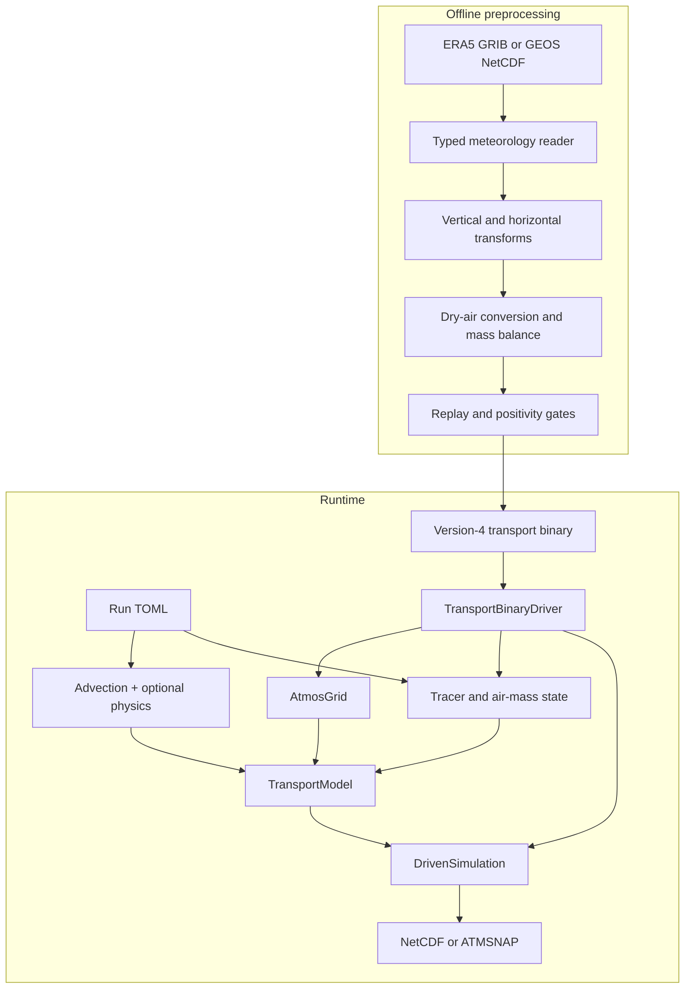

# [Architecture tour](@id Architecture-tour)

This page explains the shape of AtmosTransport before the detailed pages
introduce grids, state, operators, and binary fields. It is written for model
users first; source-code pointers are collected at the end.

## Two programs, one contract

AtmosTransport deliberately separates expensive meteorology preparation from
the repeated transport calculation:



The **transport binary** is the boundary between those programs. It is not a
generic data dump: its header declares topology, vertical coordinate, time
windows, mass basis, flux semantics, optional physics payloads, and the exact
substep schedule. The current reader accepts version 4 only.

This split keeps runtime I/O predictable and makes preprocessing assumptions
auditable. The cost is that a real-data run cannot start from raw wind files;
they must first be turned into a verified binary.

## The five runtime objects

| Object | Plain-language role | Usually created by |
|---|---|---|
| `TransportBinaryDriver` | Memory-maps forcing and loads one meteorological window at a time. | `run_driven_simulation` |
| `AtmosGrid` | Combines horizontal topology, hybrid-pressure levels, architecture, and planet constants. | Reconstructed from the binary header |
| `CellState` or `CubedSphereState` | Stores air mass and conservative `mixing ratio × carrier-air-mass` tracer fields. | Initial-condition builder |
| `TransportModel` | Bundles state, grid, face fluxes, operators, and reusable workspaces. | Runtime physics recipe |
| `DrivenSimulation` | Connects model and driver, refreshes forcing, and advances windows/substeps. | High-level runner |

For normal runs, you configure these objects indirectly through TOML and call:

```bash
julia --project=. scripts/run_transport.jl my_run.toml
```

For custom experiments, the same construction is available through
`run_driven_simulation(cfg)` or the lower-level public API.

## Configuration becomes types

A TOML file is intentionally untyped text:

```toml
[advection]
scheme = "slopes"

[diffusion]
kind = "none"
```

At the runtime boundary, AtmosTransport validates those strings and constructs
typed specifications and operators such as `SlopesScheme()` and
`NoDiffusion()`. Unsupported combinations fail before stepping—for example,
requesting TM5 convection against a binary without the four TM5 convection
fields.

Inside the model loop, Julia's multiple dispatch chooses methods from the
concrete operator, grid, state, numeric type, and architecture. The result is
one user-facing workflow without a chain of topology strings or backend
conditionals in every kernel.

## Execution backends

`[architecture] backend` accepts `"cpu"`, `"cuda"`, `"rocm"`, `"metal"`, or
`"auto"`. GPU runtimes are optional package extensions. ROCm uses AMDGPU.jl
and supports Float32 and Float64; Metal requires Float32. ROCm hardware
validation on MI300X/MI355X is pending. See the [ROCm runbook](../development/rocm.md)
for installation, opt-in smoke checks, and profiling. Auto detection tries
Metal → CUDA → ROCm on macOS, and CUDA → ROCm on Linux and other hosts,
stopping at the first functional runtime.

## Kernels written once, fused by dispatch

Work that runs independently at every index of a block can be written as a
*point operation*: a small struct (`<: AbstractPointOp` in `Architectures`)
with an `index_space` and an `apply_point!` body for one index. The same body
runs as one GPU kernel or as a loop on the CPU (an operation with much work per
index, such as the cubed-sphere surface-flux column walk, declares
`host_parallel` and runs as the kernel on the CPU backend's threads instead).
Operations compose by type:

- `Fused(ops...)` combines independent operations (disjoint writes, no
  cross reads; for example the 24 panel edges of a cubed-sphere halo
  exchange). How it runs depends on the backend (below);
- `Sequence(ops...)` launches dependent operations in order with one
  synchronization (the corner fill, which reads the filled edges).

How a backend launches a `Fused` set is its `fusion_policy`: one kernel with a
trailing slot index by default (fastest on CUDA, where these kernels are bound
by launch latency), or one launch per operation on that operation's
`bound_context` (Metal, where that is faster; the halo operations bind their
panel arrays there).

Fusing changes only how work is launched; every index performs the same
arithmetic, so results do not change. The cubed-sphere halo exchange is built
this way. With the default policy (CUDA) that is one launch for all 24 panel
edges, a second for the corners when a sweep direction asks for them, and one
synchronization; on Metal, 24 edge and 6 corner launches with bound arrays and
one synchronization. Before, a 3-D field took 24 edge launches and 6 corner
launches (one per panel, filling its four corners), and a packed tracer field
6 edge launches (one per panel) and 6 corner launches, with a synchronization
after the edges and after the corners. Measured on an NVIDIA L40S for a C90
field with 72 levels in Float32 (edges, corners and synchronization), one
exchange takes about 25 µs instead of 120 µs. Inside the packed cubed-sphere
palindrome (`strang_split_cs_mt!`) the exchanges are only queued
(`sync = false`): the palindrome synchronizes once, at its end.

Every device launch of a point operation runs over the flat linear index of
its index space and recovers the index tuple with 32-bit integer divisions
(64-bit from 2³¹ indices on). A launch over the index tuple itself puts each
workgroup along the first dimension only, so short first dimensions leave most
lanes idle: 96 of 256 for a C90 field, 3 of 256 for a halo corner fill of
width 3. On an M5 Pro the flat launch cut the GPU time of a C90 window unpack from
4.7 to 1.0 ms.

Sets of same-sized device-to-device copies go through `copy_arrays!`: on
every device backend (CUDA, ROCm, Metal), one queued `LinearCopy` launch over
the longest array instead of one `copyto!` per array, when all arrays live on
one backend (the host, and batches that mix backends, keep plain `copyto!`s).
The cubed-sphere forcing refresh copies its 18 flux panels this way at every
step. On CUDA and ROCm this saves launches; on Metal it also removes the queue
synchronization Metal.jl performs around every `copyto!`, which cost about
2.5 ms per step on an M5 Pro.

## One transport window

At a high level, each meteorological window follows this sequence:

1. The driver loads air mass, face mass fluxes, timing, and optional physics
   fields.
2. The model applies the configured number of transport substeps.
3. Advection follows its symmetric directional palindrome; diffusion and
   surface fluxes run through StepPlan’s typed midpoint hook; convection and chemistry
   run at their configured cadence.
4. Requested output times are captured without changing model state.
5. The next forcing window is loaded and checked against the same binary and
   model contracts.

During cubed-sphere startup, each tracer's initial dry VMR is converted directly
into its slot in the packed model state. This avoids retaining a second complete
set of tracer-mass arrays. Signed values and zero initial halos are preserved.
The current cubed-sphere runner requires dry-basis transport binaries.

Across input files, the runner retains the model's state and numerical
workspaces. A new `DrivenSimulation` refreshes forcing, diffusion layer
thickness, and convection caches for the next file. It carries the accumulated
simulation clock forward, so time-varying emissions continue at the correct
time. GPU prefetch is drained before the runner closes an input driver. When
the next file has the same window layout, the new simulation refills the
previous one's window buffers instead of allocating new ones.

On a GPU, a cubed-sphere transport binary whose on-disk element type is the
run's is loaded window by window with concurrent reads of the payload and
unpacking kernels on the device. With discrete device memory (CUDA, ROCm) the
reads fill page-locked host memory, uploaded section by section through a
section-sized device buffer (`MetDrivers.RawWindowStaging`). With unified
memory (Metal, `Architectures.host_memory_model`) the reads fill a
shared-storage device buffer that the unpack kernels read in place
(`MetDrivers.MappedWindowStaging`): Metal.jl's host-to-device `copyto!`
synchronizes the queue and stages through a temporary buffer on every call.
Either way the device window equals the upload of a window loaded on the
host. Other binaries are converted on the host into a page-locked staging
window.

The detailed operator ordering is documented in [Operators](@ref Operator-concepts). The mass
invariant is derived in [Mass conservation](@ref).

## Where the source lives

The source tree mirrors the concepts above:

```text
src/
├── Grids/           horizontal meshes and hybrid-pressure coordinates
├── State/           air mass, conservative tracer storage, forcing fields, and accessors
├── Operators/       advection, diffusion, convection, surface flux, chemistry
├── MetDrivers/      version-4 binary reader, driver, and window carriers
├── Models/          runtime composition; stable Models and child-module paths
│   ├── Core/        model, simulation, callbacks, stepping and adjoint schedule
│   ├── Physics/     runtime specs, recipes, metadata and forcing refresh
│   ├── InitialConditions/  IC and surface-flux loading
│   └── Runner/      driven simulation, binary paths, staging and runtime orchestration
├── Diagnostics/     core run budgets, snapshot series and mass drift
├── SectionTimer.jl  foundation timing and optional NVTX instrumentation
├── Preprocessing/   source readers, transforms, balancing, verification, writers
├── Output/          snapshot capture and NetCDF/ATMSNAP persistence
├── Observations/    observation interfaces, loaded after Output and before Adjoints
│   ├── Retrievals/  retrieval columns and averaging kernels
│   ├── Sources/     sources, requests, schedules and readers
│   └── Sampling/    location, placement, gathers, sampler and observation NetCDF
├── Regridding/      conservative offline remapping
├── GriddedIO/       conventions of gridded input files (coordinates, time axes, flux units, flux-file schemas)
├── Adjoints/        reverse operators and objective seeding
├── Tape/            checkpoint schedules and tape storage
├── Footprint/       forward-record/reverse-loop footprint workflows
├── Inversion/       observations, covariance, cost functions, and optimizers
└── Extras/          non-core, no tests, each folder intended as a separate package
    ├── Downloads/      DataDownloads: data-source protocols and acquisition
    ├── Visualization/  snapshot views and optional Makie integration (ext/ stays)
    └── Analysis/       bands, decompositions, skill statistics and reference archives
```

The top-level `src/AtmosTransport.jl` defines the package and curated exports.
Most major directories own a module; `Footprint/` and `Inversion/` are
assembled by `Adjoints`. Module-level READMEs provide implementation maps for
the core runtime directories.

Modules are included in dependency order, and a module may use only the
modules included before it:

```text
Architectures → SectionTimer → ConfigChecks → LogLevels → AtomicFiles
→ Quantities → Parameters → Grids → State → Output → Observations → MetDrivers → Operators
→ Tape → Adjoints → Regridding → GriddedIO → Preprocessing → Models → Diagnostics
→ Extras/Visualization → Extras/Analysis → Extras/Downloads
```

`Diagnostics` keeps the run mass-budget checks and their snapshot-reader and
global-total helpers in core. `Analysis` re-exports these names, so diagnostic
scripts keep using `AtmosTransport.Analysis`. Visualization, Analysis
post-processing and DataDownloads live under `src/Extras/`; their module names
and plotting exports stay the same. They have no tests and each folder is
intended to become its own package. Core must never import Extras; Extras use
public core names and helpers declared shared in the owning README. Julia's
optional Makie extension remains in `ext/`.

Three single-file modules depend on Base and the standard library only:
`ConfigChecks.jl` checks TOML tables, `LogLevels.jl` applies the
`[logging] level`, and `AtomicFiles.jl` publishes a file only when it is
complete (a sibling staging file, renamed onto the target on success); the
transport-binary writers and the spectral and regridder caches write through
it.

`GriddedIO` is the single owner of the conventions of native gridded input
files: coordinate discovery by name, fill policy, lat-lon orientation, source
lat-lon meshes, CF time decoding, the surface-flux unit grammar, staging of
compressed inputs, and the `cs_native` and lat-lon flux-file schemas (reader
and writer). It sits below both of its consumers, so the runtime
initial-condition and surface-flux loaders in `Models` and the preprocessing
code read and write these files through the same functions. See
[GriddedIO](@ref GriddedIO-API) for the API.

## Contributor structure checks

The test-only JuliaSyntax checker at `scripts/checks/check_structure.jl`
parses the include tree and extensions without loading the package. The
allowed internal module and folder edges live in `src/LAYERS.toml`, along
with a one-directional folder order and reasoned exceptions for existing
reverse edges. Core modules cannot depend on Visualization, Analysis,
DataDownloads, the Makie extension, or future Extras modules. Existing duplicate
helpers, exact body clones, cross-module private uses, and detached docstrings
are snapshotted in `test/structure/`. New violations fail, and allowances only
shrink relative to a validated base ref; a missing base fails. Each folder has a
65,000-token size budget (immediate Julia source bytes / 3.5), with exact
shrink-only size allowances for today's oversized folders. README contract
headings are reported only in this first rollout.

The snapshots are keyed by module, folder and file names. A change that moves,
renames or splits a unit declares each budget transfer as a reviewed row in
`test/structure/migrations.toml`; the
[structure ratchet page](../development/structure.md) gives the rules. After
the merge the rows are inert, and the next edit of that file deletes them.

Read the [generated code map](../development/code_map.md) and the folder
README before editing. The map lists each folder's files, size, dependencies,
users, public-name count, and forward/adjoint mirrors. The structure gate
checks that it matches the source; regenerate it with
`julia --startup-file=no --project=test scripts/checks/check_structure.jl --write-code-map`.

Run `CUDA_VISIBLE_DEVICES= scripts/dev/quick_gate.sh origin/main` to check
structure alongside required keywords, whitespace, and the selected CPU
tests. `test/structure/README.md` describes the snapshots and static-analysis
limits. Numerical behavior is unchanged by these checks.

## Public workflow versus extension points

The stable path for a model user is deliberately small:

```text
preprocess_transport_binary.jl -> version-4 binaries
run_transport.jl               -> configured forward run
inspect_transport_binary.jl    -> forcing diagnostics
```

The lower-level types are public because research workflows often need custom
state initialization, operator experiments, or adjoint objectives. New code
should extend the owning abstraction—such as an `AbstractConvection` method or
an `AbstractMetReader`—instead of adding a parallel runner.

## Continue through the user guide

1. [Grids](@ref) explains the three horizontal topologies and what the binary
   infers for you.
2. [State & basis](@ref) explains why tracers use conservative mass-like
   storage while users configure and read dry mixing ratios.
3. [Operators](@ref Operator-concepts) describes the selectable physics and their ordering.
4. [Binary format](@ref Binary-format) documents the preprocessing/runtime
   contract in detail.
