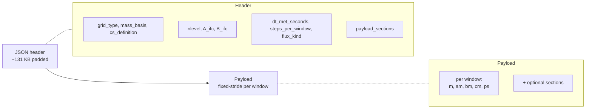

# Binary format

The transport binary is the I/O contract between **preprocessing** and
**runtime**. One file per day; the runtime memory-maps the payload and
streams it window-by-window. The format is self-describing — a JSON
header at the start tells the runtime everything it needs to construct
the correct grid, dispatch the correct operators, and validate the
contract via the replay gate.

This page covers what's in the file from a user's standpoint: what the
header tells you, what the payload sections mean, which optional
sections enable which runtime capabilities, and how the replay gate
catches binaries that don't satisfy the conservation contract.

## Schema overview



The on-disk layout is **flat**: header then a fixed number of bytes
per window (`bytes_per_window`), one window after another. Memory
mapping makes the per-window stride a simple offset; sub-window I/O
costs nothing on warm caches.

## The JSON header

Every binary opens with a JSON document (typically padded to ≈131 KB)
encoding a `TransportBinaryHeader` (or its CS analogue). The fields
the runtime actually dispatches on:

| Field | Type | Meaning |
|---|---|---|
| `grid_type` | `Symbol` | `:latlon`, `:reduced_gaussian`, or `:cubed_sphere` |
| `horizontal_topology` | `Symbol` | `:structureddirectional` (LL: `Nx × Ny`) or `:faceindexed` (RG: flat `ncells`) |
| `ncell` | `Int` | total horizontal cells |
| `nface_h` | `Int` | total horizontal faces |
| `nlevel` | `Int` | vertical levels (`k = 1` is TOA, `k = nlevel` is surface) |
| `A_ifc`, `B_ifc` | `Vector{Float64}` | hybrid-σ-pressure coefficients at `nlevel + 1` interfaces, in Pa and dimensionless |
| `mass_basis` | `Symbol` | `:dry` or `:moist` (see [Mass basis contract](#Mass-basis-contract) below) |
| `surface_pressure_basis` | `AbstractSurfacePressureBasis` | JSON value `"total"` or `"dry"`, parsed once as `TotalSurfacePressure()` or `DrySurfacePressure()`; states whether `:ps` is moist-air hybrid-coordinate pressure or dry column pressure |
| `panel_convention` | `Symbol` | CS only — `:gnomonic` or `:geos_native` |
| `cs_definition` | `Symbol` | CS only — `:equiangular_gnomonic` or `:gmao_equal_distance` |
| `cs_coordinate_law` | `Symbol` | CS only — e.g. `:equiangular_gnomonic` or `:gmao_equal_distance_gnomonic` |
| `cs_center_law` | `Symbol` | CS only — `:angular_midpoint` or `:four_corner_normalized` |
| `longitude_offset_deg` | `Float64` | CS only — final longitude rotation, `-10.0` for GEOS native |
| `planet_radius_m` | `Float64` | radius [m] of the mesh on which the preprocessor computed cell areas and air masses; the runtime builds its mesh with it. Preprocessing targets use `EARTH_RADIUS` (6 371 000 m), which is also the fallback for binaries without the key. `IFS_EARTH_RADIUS` (6 371 229 m) is reserved for physical IFS/TM5 source calculations and legacy binaries that explicitly recorded it. |
| `dt_met_seconds` | `Float64` | met-window cadence (typically 3600 s for hourly ERA5) |
| `steps_per_window` | `Int` | compatibility scalar, equal to `maximum(steps_per_window_by_window)` |
| `steps_per_window_by_window` | `Vector{Int}` | required v4 per-window substep schedule used by replay gates and runtime stepping |
| `time_step_schedule` | `Symbol` | `:constant` or `:per_window` |
| `flux_sampling` | `Symbol` | `:window_start_endpoint`, `:window_constant`, or `:window_mean` |
| `flux_kind` | `Symbol` | `:substep_mass_amount` or `:full_window_mass_amount` |
| `float_type` (JSON key; struct field `on_disk_float_type`) | `Symbol` | `:Float32` or `:Float64` |
| `nwindow` | `Int` | windows per day (typically 24) |
| `payload_sections` | `Vector{Symbol}` | which arrays this binary actually contains |

`format_version` is currently `4`; all other transport binaries are intentionally
rejected and must be regenerated. The v4 contract requires
`steps_per_window_by_window :: Vector{Int}` (per-window adaptive substep
schedule) and `poisson_balance_target_scale_by_window :: Vector{Float64}` in
the header. `header_bytes` and a few sampling-metadata fields
(`source_flux_sampling`, `air_mass_sampling`, `humidity_sampling`,
`delta_semantics`, optional `runtime_substep_contract`) round out the header.
The full list lives in `src/MetDrivers/BinaryFormat/header.jl`.

Every current writer also emits a schema-2 flux-fidelity certificate. The
reader decodes its status and construction kind into nominal types
(`FidelityPassed`, `FidelityFailed`, `FidelityNotApplicable`,
`FidelityUnavailable`; and `WindRederivedFidelity`,
`NativePassthroughFidelity`, or `NoFluxFidelityKind`). Downstream code therefore
dispatches on types rather than switching on `Symbol` values. A pre-C6 v4 file
remains readable but is represented as `FidelityUnavailable` with reason
`legacy_header_missing`.

Interface coefficients are read through `reader.header.A_ifc` and
`reader.header.B_ifc`. Use `has_surface(reader)` to query PBL surface
payload availability. The reader constructor validates required header
fields and complete optional payload groups before any window is loaded.

## Payload sections

### Required for any transport binary

- `:m` — air mass per cell, kg. Shape `(Nx, Ny, Nz)` for LL,
  `(ncells, Nz)` for RG, `NTuple{6, (Nc, Nc, Nz)}` for CS.
- **Horizontal mass fluxes**:
  - LL / CS: `:am`, `:bm` through x-faces and y-faces. Shapes have
    one extra cell along the staggered axis (`(Nx+1, Ny, Nz)` /
    `(Nx, Ny+1, Nz)`). CS stores six per-panel arrays of the same
    staggered shape — one canonical face array per panel; no halo
    packing.
  - RG: a single face-indexed `:hflux` array of shape
    `(nface_h, Nz)` (the unstructured analogue — one entry per
    horizontal face under the LCM-segmented ring topology).
- `:cm` — vertical mass flux at level interfaces, shape extends `Nz`
  by 1 along the vertical axis.
- `:ps` — surface pressure per cell, in Pa.

The JSON header distinguishes three dry-mass states:

- pinned binaries record a recognized enable flag as `true` and the common
  baseline as `mass_fix_target_ps_dry_pa`;
- explicitly unpinned binaries record a recognized enable flag as `false`,
  omit the target, and inspection reports `sum(m) g / (4 pi R_header^2)` from
  window 1 as `:unpinned_window1`;
- legacy binaries record no enable flag, so inspection uses the same window-1
  fallback but reports the pin state as unknown.

A multi-file run rejects conflicting explicit pin states before comparing the
effective targets of pinned and legacy files. Explicitly unpinned files are not
compared to one another because their carried mass may drift continuously.
Legacy enabled headers without a numeric target are pinned window-1 fallbacks.
Moist-basis fallbacks use `m(1-qv_start)`; without humidity their dry target is
unclassifiable.
The canonical enable flag is `mass_fix_enabled`; inspection also recognizes
the source-specific flags in older native-source archives.

Current writers require the typed `surface_pressure_basis` keyword and record
`"total"` or `"dry"`; it is never inferred from `mass_basis`.
The reader parses it once to a `TotalSurfacePressure` or `DrySurfacePressure`
type, and transformations preserve that typed value. For a legacy binary that
lacks the key, opening the reader compares window 1 `:ps` with the column
pressure implied by `:m`, stores the inferred type, and emits one warning; this
compatibility fallback becomes an error after archive regeneration.

Dry-pressure binaries use `:qv_start` when present, or VDIFF `:vdiff_qv` on
native cubed-sphere physics binaries, to reconstruct total pressure for hybrid
interface placement and runtime diffusion thickness. ERA5-N320 CS products
without either humidity payload use `ps_total ≈ ps_dry`; total pressure is then
unobservable: the runtime retains dry `ps`, warns once, and documents the
typically 0.5--2 % low humid-column approximation.

### Optional sections (each enables a runtime capability)

| Section(s) | Capability unlocked |
|---|---|
| `:dm` on CS, or `:dam` / `:dbm` / `:dcm` on LL | Endpoint mass/flux deltas required by the strict load-time replay gate. |
| `:qv_start`/`:qv_end` | Specific-humidity endpoints for interpolation and moist-conversion bookkeeping. |
| `:cmfmc` (+ optional `:dtrain`) | `CMFMCConvection` operator (GCHP-style). |
| `:entu`, `:detu`, `:entd`, `:detd` (all four) | `TM5Convection` operator (TM5 four-field). |
| `:pblh`, `:ustar`, `:pbl_hflux`, `:t2m` | Surface payload — feeds the `WindowPBLKzField` runtime Kz path. |
| `:vdiff_u`, `:vdiff_v`, `:vdiff_t`, `:vdiff_qv` | GEOS VDIFF state — feeds the `LocalHoltslagBovilleKzField` local Kz. |
| `:dkg` | Exact TM5 dry-air interface exchange [kg s⁻¹] between layers `k` and `k+1`; the final level is the zero-flux surface boundary. |
| `:pbl_eflux` (CS, with the surface sections) | Upward latent heat flux [W m⁻²]; with the VDIFF sections it enables GEOS-Chem's non-local PBL scheme (`geoschem_nonlocal_vdiff`, `GCHPNonlocalPBLField`). Loaded into `surface.eflux`. |
| `:cmfmc_cloud_base` (CS, with `:cmfmc`) | Convective cloud-base layer, a top-down index stored as a float (GEOS-Chem: lowest layer with DQRCU > 0); used by `[convection] cloud_base = "dqrcu"`. |

The PBL surface and GCHP VDIFF sections together replace the older "constant
or profile-shaped Kz from runtime config" model. Cubed-sphere runs with
`diffusion.kind = "tm5_beljaars_viterbo_local_kz"` consumes
the four surface fields from the binary at each window; the GCHP VDIFF
non-local Kz path consumes the four `:vdiff_*` fields. The `ImplicitVerticalDiffusion`
operator still also supports static `ProfileKzField` / `ConstantField` when no
binary Kz payload is present.

A run config that asks for an operator the binary does not carry is
rejected at load time — the `inspect_binary` capability NamedTuple is
the single source of truth for what the runtime can wire up.

## The `inspect_binary` capability surface

```julia
using AtmosTransport
caps = AtmosTransport.inspect_binary("/path/to/transport.bin")
```

returns a `NamedTuple`:

| Field | Meaning |
|---|---|
| `advection :: Bool` | `true` iff structured `:m/:am/:bm/:cm` or face-indexed RG `:m/:hflux/:cm` sections are present |
| `replay_gate :: Bool` | `true` iff the endpoint mass/flux deltas needed for replay are present |
| `tm5_convection :: Bool` | `true` iff all four TM5 sections are present |
| `tm5_convection_provenance` | recorded source of the TM5 sections: `tm5_convection_source`, `tm5_ec2tm_convention`, `convection_attachment` (key => value pairs; empty when none is recorded). Opening a binary rejects ERA5-derived sections without the current `tm5_ec2tm_convention` (see the [Conventions cheat sheet](@ref)) |
| `cmfmc_convection :: Bool` | `true` iff `:cmfmc` is present (CS only) |
| `pbl_diffusion :: Bool` | `true` iff the four PBL surface sections (`:pblh`, `:ustar`, `:pbl_hflux`, `:t2m`) are present (CS only) |
| `gchp_vdiff :: Bool` | `true` iff all GCHP VDIFF fields and all four PBL surface fields are present (CS only) |
| `gchp_nonlocal_vdiff :: Bool` | `gchp_vdiff` plus `:pbl_eflux` (CS only) |
| `cmfmc_cloud_base :: Bool` | `true` iff `:cmfmc_cloud_base` is present |
| `surface_pressure :: Bool` | `true` iff `:ps` is present |
| `humidity :: Bool` | `true` iff both `:qv_start` and `:qv_end` are present |
| `mass_basis :: Symbol` | `:dry` or `:moist` (echoed from header) |
| `grid_type :: Symbol` | `:latlon` / `:reduced_gaussian` / `:cubed_sphere` |
| `flux_kind :: Symbol` | `:substep_mass_amount` or `:full_window_mass_amount` |
| `nlevel :: Int` | vertical levels |
| `nwindow :: Int` | met windows in the file |
| `window_seconds :: Float64` | length of one met window (`dt_met_seconds`) |
| `write_replay_check :: Bool` | `false` only when the binary was written with the write-time replay gate skipped (header `write_replay_check = false`) |
| `steps_per_window :: Int` | scalar substep count (`maximum(steps_per_window_by_window)`) |
| `variable_step_schedule :: Bool` | `true` iff per-window step counts are not all equal |
| `adaptive_substeps :: Union{Nothing, Bool}` | explicit `adaptive_substeps` header value for CS; `nothing` when not recorded |
| `preprocessor_contract :: Union{Nothing, String}` | preprocessor contract tag (CS only); e.g. `"plan41_variable_substeps"` |
| `vertical_Nz_output :: Union{Nothing, Int}` | preprocessor-recorded output level count for CS; `nothing` otherwise |
| `dry_mass_target_ps_pa :: Union{Nothing, Float64}` | recorded target, or window-1/header-radius fallback; `nothing` when moist mass lacks humidity |
| `dry_mass_target_source :: Symbol` | `:header`, `:legacy_window1`, `:unpinned_window1`, or `:unclassifiable` |
| `dry_mass_target_is_current :: Bool` | agrees with `Parameters.GLOBAL_MEAN_DRY_SURFACE_PRESSURE` |
| `payload_sections :: Vector{Symbol}` | the raw list, for advanced filtering |

The CLI tool `scripts/diagnostics/inspect_transport_binary.jl` is a
thin wrapper over `inspect_binary` that pretty-prints these rows. See
[Inspecting output](@ref) for example output.

## Mass-basis contract

The `mass_basis` header field encodes a hard contract over the
payload's water bookkeeping:

| `mass_basis` | What `:m` represents | What `:am`, `:bm`, `:cm`, `:dm` represent |
|---|---|---|
| `:dry` | Dry-air mass per cell (`DELP_dry / g · area` from `DELP_moist · (1 − qv)`) | Dry-air mass fluxes, dry-air mass deltas |
| `:moist` | Total (moist) air mass per cell | Total (moist) air mass fluxes and deltas |

The runtime constructs `state.air_mass` on the same basis as the
binary; mixing a `:moist` binary with the dry-basis runtime contract
is rejected when the `DrivenSimulation` is constructed (not at the
raw binary-open call) — but well before any windows actually step,
so it is a hard wiring error rather than a silent corruption.
Convection forcing operators (`CMFMCConvection`, `TM5Convection`)
are basis-polymorphic — they consume forcing arrays on whatever
basis `state.air_mass` carries.

By default the entire pipeline ships dry: ERA5 spectral preprocessing
applies the `(1 − qv)` correction and writes `mass_basis = :dry`; the
GEOS native CS path does the same via dry-basis `DELP` reconstruction
and a column balance against the raw next-hour dry endpoint, with the
final `cm` diagnosed from the balanced fluxes via `diagnose_cs_cm!`.
See [State & basis](@ref) for how this propagates to runtime tracer
semantics.

## Streaming writer entrypoints

Two writer entry points cover the topology axis. Users rarely call
either directly — the preprocessor's unified driver
(`run_unified_preprocessor_day!`) wraps them — but the kwargs are
useful to know when reading the source. Example calls (defaults are
from `src/MetDrivers/BinaryFormat/streaming_writer.jl` and
`src/MetDrivers/BinaryFormat/cubed_sphere.jl`):

```julia
# Reduced Gaussian (face-indexed). LatLon goes through a separate
# write path inside the spectral preprocessor.
writer = open_streaming_transport_binary(
    path, grid, nwindow, sample_window;
    FT = Float64,
    dt_met_seconds        = 3600.0,
    steps_per_window      = 2,   # default; overwritten with adaptive schedule
    mass_basis            = :dry,   # required, no default
    surface_pressure_basis = DrySurfacePressure(), # required; meaning of :ps
    flux_kind             = :substep_mass_amount,
    flux_sampling         = :window_start_endpoint,
    air_mass_sampling     = :window_start_endpoint,
    humidity_sampling     = :auto,
    delta_semantics       = :auto,
    source_flux_sampling  = :window_constant,    # required kwarg, no default
    extra_header          = Dict(),
)

# Cubed-sphere
writer = open_streaming_cs_transport_binary(
    path, Nc, npanel, nlevel, nwindow, vc;
    FT = Float64,
    dt_met_seconds = 3600.0,
    steps_per_window = 4,
    mass_basis = :dry,              # required, no default
    surface_pressure_basis = DrySurfacePressure(), # required; meaning of :ps
    include_flux_delta = false,    # writes :dm (CS only; no :dam/:dbm/:dcm)
    include_cmfmc = false,         # writes :cmfmc when true
    include_dtrain = false,        # writes :dtrain when true (requires include_cmfmc)
    include_surface = false,       # writes :pblh, :ustar, :pbl_hflux, :t2m
    include_tm5conv = false,       # writes :entu, :detu, :entd, :detd
    include_gchp_vdiff = false,    # writes :vdiff_u, :vdiff_v, :vdiff_t, :vdiff_qv
    include_pbl_eflux = false,     # writes :pbl_eflux (window.surface.eflux; requires include_surface)
    include_cmfmc_cloud_base = false, # writes :cmfmc_cloud_base (requires include_cmfmc)
    panel_convention = :gnomonic,  # or :geos_native
    cs_definition = :equiangular_gnomonic,
    cs_coordinate_law = :equiangular_gnomonic,
    cs_center_law = :angular_midpoint,
    longitude_offset_deg = 0.0,
    planet_radius = mesh.radius,   # required: radius of the mesh the air masses were computed on
    extra_header = Dict(),
)
```

The `include_*` knobs control which optional sections land in the
binary; the CS reader's `binary_capabilities` then advertises whatever
you asked for. `include_dtrain = true` without `include_cmfmc = true`
is rejected at writer-open time. `source_flux_sampling` is a required
kwarg on the RG path — it has no default because the LL spectral path
and the GEOS-CS-source path use it differently.

## Replay gate

Mass conservation is enforced by a **two-stage replay gate**:

### Write-time gate (on by default)

Before each window is written, the preprocessor evolves the stored air mass
`m_n` forward one window with the window's flux fields, under the runtime's
palindrome continuity, and compares the result with the stored endpoint
`m_{n+1}` (`verify_window_continuity` in
`src/MetDrivers/ReplayContinuity.jl`):

```
m_evolved[c] = m_n[c] − 2N · (div_h[c] + cm[c, k+1] − cm[c, k])
|m_evolved[c] − m_{n+1}[c]| ≤ tol · (|m_n[c]| + |m_{n+1}[c]| + 2N Σ_faces |F[c]|)
```

Here `N` is the window's substep count, `div_h` the horizontal divergence of
the per-substep face mass amounts and `c` runs over all cells of the grid (of
one panel on the cubed sphere). The sum runs over the cell's horizontal and
vertical face fluxes. The residual is measured against the
summed magnitudes of the cell's own budget terms, the scale its rounding
error is bounded by. `tol = replay_tolerance(FT)`
(`src/MetDrivers/ReplayContinuity.jl`) is `REPLAY_TOLERANCE_FLOAT64 = 1e-12`
or `REPLAY_TOLERANCE_FLOAT32 = 1e-5` from `src/Parameters`; in 2026-10 the
golden and sampled production binaries measured at most `6.5e-14` (Float64)
and `1.0e-6` (Float32). A binary that fails this gate is **rejected at write
time**; the preprocessor errors out rather than producing a
known-bad file. Diagnostic runs can explicitly bypass this gate with
`[numerics] write_replay_check = false` in the preprocessing config (or
`--no-write-replay-check` for
`scripts/preprocessing/regrid_ll_transport_binary_to_cs.jl`); production
preprocessing should not. Such a binary records `write_replay_check = false` in
its header, the inspector marks it, and the runtime warns when it opens it.

### Load-time gate (opt-in)

The runtime can re-run the same replay check when it opens each binary.
Enable it in the run config, or as a driver keyword:

```toml
[input]
validate_replay = true
```

```julia
# When constructing the driver directly (advanced)
driver = TransportBinaryDriver(path; validate_replay = true)
```

The write-time gate (above) is on by default. The load-time gate uses the
same per-cell test; for a binary loaded in a different float type than it
is stored in, the less precise of the two sets the tolerance. A failure
throws an `ArgumentError` with the worst-cell location and tolerance margin,
pointing the user at binary regeneration.

The load-time gate is **off by default** because it doubles binary
load time; it is the recommended sanity check for any new binary
configuration before running a long production simulation.

### What the replay gate certifies

Every preprocessor that builds a binary from meteorological data (lat-lon,
reduced Gaussian, and every cubed-sphere source) derives `cm` from the
window's horizontal fluxes immediately before the gate: from the endpoint
tendency `dm = (m_{n+1} − m_n) / 2N` (`recompute_cm_from_dm_target!`, or
`diagnose_cs_cm!` on the cubed sphere), or, in the diagnostic-only GEOS
pressure-fixer closures, by FV3's `ΔB` rule with the endpoint mass itself
chained from the same fluxes. The replay error therefore reduces to each
column's mass budget, the mismatch between the column-integrated horizontal
convergence and the column mass change, which the horizontal balance has
just enforced (or which holds by construction). The experimental cubed-sphere
coarsener (`coarsen_nested_cs_transport_binary`) is different: it block-sums
the source binary's `am`, `bm` and `cm`, so its gate checks that the coarsened
fields still fit together, while the fidelity of the fluxes is inherited from
the source binary. A passing binary is self-consistent:

- the balance converged, so every column's budget closes;
- the stored `cm` closes the explicit-`dm` budget layer by layer;
- rounding to the storage precision keeps the closure. Every topology's
  write-time gate checks the arrays in the output storage type;
- the substep count used to diagnose `cm` matches the one in the replay, and
  consecutive windows chain (the last window of a day closes against the
  first mass of the next day when it is available);
- at load time, the file as the runtime reads it (flux kind, per-window
  substep counts) still integrates to its stored endpoints, which also
  catches stale or damaged binaries.

The replay gate alone does **not** validate the winds. Because `cm` is re-diagnosed from
the same fluxes it checks, it cannot detect:

- horizontal flux errors that leave every column's budget intact: a
  non-divergent (rotational) error, `am`/`bm` with their levels flipped, or
  horizontal transport moved between levels of a column. On a synthetic
  72 × 36 × 10 window all three pass at about `1e-16`, while one column with
  a broken budget fails at `0.38`;
- a wrong vertical distribution of the mass tendency, including a `cm` that
  is close to zero: a horizontal balance that closes every layer on its own
  leaves no vertical mass flux and still passes;
- a nonzero `cm` at the model top and the surface that is the same at every
  interface of a column (mass entering at the top and leaving at the
  surface): only the differences `cm[k+1] − cm[k]` enter the replay. The
  `cm` diagnosis sets both boundary values to zero, but the gate does not
  check them;
`test/core/test_replay_consistency.jl` ("Replay gate scope") checks these
statements. The independent flux-fidelity gate below covers the corresponding
source comparison for newly generated binaries.

## Flux-fidelity gate and header certificate

Before balance and before payload serialization, paths that have winds
independently reconstruct deterministic sampled face amounts from source
`u`, `v`, and layer pressure thickness `Δp`:

```math
F_f = \frac{\Delta t_{\mathrm{amount}}}{g}
      \int_f [(u\,\mathbf e_\lambda+v\,\mathbf e_\phi)\cdot\mathbf n_f]
      \,\Delta p\,dl.
```

The evaluator is scalar and separate from the bulk constructor. It implements
the selected panel-average, vector/FV3, or line-integral definition directly.
For line integrals it rebuilds all 16 midpoint locations and their four-cell
source interpolation weights from the source and target meshes; it never reads
the production sparse operator. The direct stencils for the selected faces are
cached once per workspace and reused at subsequent endpoints, and the moist
layer thickness `|ΔA + ΔB p_s|` is evaluated only at the stencil cells.
Independence has limits that the certificate cannot remove:

- the panel-average and line-integral evaluators are independent of the
  production constructors; the vector evaluator re-evaluates the face formula
  but reuses the production face geometry and FV3 filter (`_vector_face_value`,
  face lengths), so it catches assembly, scatter and time-scaling errors, not
  geometry errors;
- reference and candidate read the same input arrays (winds, pressure
  thickness, humidity), so no check can catch an input error: wrong
  registration, level order or units pass;
- native GEOS fluxes have no independent source to rederive them from. Their
  certificate is `not_applicable` with reason `native_fluxes_not_rederivable`
  (kind `native_passthrough`) and records only the balance correction.

Each topology has a deterministic sample rule (`flux_fidelity_sample_rule`):
`cs_stratified_faces_v1` (cubed sphere: seams, panel corners, interior),
`structured_hashed_faces_v1` (lat-lon: 256 faces ranked once per workspace;
only their columns are rebuilt, through the same vertical map) and
`rg_hashed_latitude_lines_v1` (reduced Gaussian: about 256 faces on at most
32 latitude lines, so the check re-synthesizes about 32 of the `2 n_rings − 1`
lines production synthesizes, with the same spectral transform). The fixed
SplitMix64 seed and canonical face identifiers make each map stable across
processes and prevent counting panel-seam mirrors twice. All levels of each
selected face are checked. Adaptive paths discard rejected schedules and
certify only the accepted amount duration. Each window states its effective
time sampling; when a `window_mean` run reaches an archive boundary without a
next day, the final window uses the start fluxes
(`window_start_boundary_fallback`, also `flux_time_sampling_effective` in the
header) and the certificate records `flux_fidelity_time_sampling = "mixed"`
with `flux_fidelity_time_sampling_by_window`.

For reference `F_r` and independently computed `F_c`, the recorded errors are

```math
e_{\rm abs}=|F_c-F_r|,\qquad
e_{\rm rel}=\frac{e_{\rm abs}}
 {\max(|F_c|,|F_r|,F_{\rm floor})},
```

where, for the file precision `FT` and the maximum sampled magnitude
`F_scale`,

```math
F_{\rm floor}=\max(\operatorname{floatmin}(FT),
                    \epsilon(FT)\max(F_{\rm scale},1\ {\rm kg})),
```

```math
T_{\rm abs}=64\epsilon(FT)\max(F_{\rm scale},1\ {\rm kg}),\qquad
T_{\rm rel}=256\epsilon(FT).
```

A sample passes when `e_abs ≤ T_abs` or `e_rel ≤ T_rel`; equivalently it fails
only when both limits are exceeded. Failure occurs before that window's payload
is written. The certificate records maximum/RMS absolute and relative errors,
maximum ULP distance, both tolerances and the scale floor, sample coverage,
the worst window/face/level, method and effective duration. Because column
Poisson balance intentionally changes fluxes, its effect is separate. With
`Δ = F_balanced − F_r` at every sampled face and level of every window (for
native GEOS fluxes `F_r` is the native amount), the header records the largest
`|Δ|` (`balance_correction_max_abs_kg`) and the flux-weighted relative
correction

```math
\frac{\mathrm{RMS}(\Delta)}{\mathrm{RMS}(F_r)} =
\sqrt{\frac{\sum \Delta^2}{\sum F_r^2}},
```

over all samples (`balance_correction_rms_relative`) and per level, whose
largest value and level (1 = top) are `balance_correction_max_level_rms_relative`
and `balance_correction_max_level`; `RMS(F_r)` is floored at `F_floor`. A
per-sample ratio `|Δ|/|F_r|` is not recorded: faces whose pre-balance amount is
near zero dominate it (golden headers of the earlier definition: maxima of
6.5e13 on the ERA5 72 × 37 lat-lon golden, 1.3e4 on GEOS-IT C45).

Where source pressure velocity is available, the writer normalizes it to the
same dry basis, time sampling, grid, and vertical coordinate and compares it
with the stored downward interface amount through

```math
\omega_{cm}=\frac{g\,cm}{A_{cell}\Delta t_{amount}}.
```

The OMEGA certificate records bias, RMSE, normalized RMSE, maximum error,
slope, correlation, bottom residual, and NRMSE in the surface–700, 700–300,
300–100, 100–10, and below-10 hPa bands, with
`NRMSE = RMS(ω_cm − ω_src)/RMS(ω_src)`. It passes only when it has samples,
every metric is finite, and the named, versioned per-path baseline
(`omega_fidelity_baseline_id`: `merra2_wind_omega_v3`, `geos_native_omega_v3`)
holds all three gates, recorded in the header:

- `NRMSE < 1.0` (`omega_fidelity_nrmse_limit`): `NRMSE = 1` is the score of
  `cm ≡ 0`, so the stored vertical transport must be closer to the source than
  none at all;
- correlation `> 0.5` (`omega_fidelity_correlation_min`);
- `0.5 < slope < 1.5` (`omega_fidelity_slope_min`, `omega_fidelity_slope_max`),
  the least-squares slope of `ω_cm` on `ω_src`.

A zero `cm` (NRMSE 1, r 0), a sign-flipped one (NRMSE ≈ 2, r = −1) and a
level-flipped one (NRMSE ≈ 1.4) fail; MERRA-2 wind-derived C90 measures NRMSE
0.47, r 0.89, slope 0.87 (2.1× margin). The slope bounds catch an amount or
time-convention error (`2n` against `n` substeps, the 8× `mass_flux_dt` error,
a factor `g`): it scales `cm` uniformly, which scales the slope by the same
factor `s` but leaves the correlation unchanged, and NRMSE stays below 1 for
`s` down to 1/20 (on a source with the MERRA-2 C90 statistics: NRMSE 0.61 at
`s = 1/2`, 0.89 at 1/8). The bounds are symmetric about the measured 0.865 in
log space (`0.865/1.73` and `0.865 × 1.73`), so `s = 2` (slope 1.73) and
`s = 1/2` (0.43) fail. An aggregate failure writes a `failed`
certificate (`omega_fidelity_passed = false`) and quarantines the staged file.
MERRA-2 compares the OMEGA of its winds collection (`tavg3` block mean or
`inst3` block start, recorded in `omega_fidelity_source`/`_sampling`) on the
dry basis of each sub-window's own start humidity. When winds or OMEGA are not
present, numeric metrics are omitted (never NaN) and a typed `not_applicable`
or `unavailable` reason is recorded.

The reader checks each certificate for consistency and rejects one that a
writer cannot produce: a `passed` flux certificate is `wind_rederived`, covers
`nwindow` windows with `sample_count = windows × samples_per_window × nlevel`
and carries every metric, finite; a `native_passthrough` certificate is
`not_applicable` with finite balance-correction metrics; a certificate without
samples carries no metrics; a `passed` OMEGA certificate has samples, finite
metrics, `omega_fidelity_passed = true` and satisfies its own recorded gates.
The writer enforces the same coverage before it patches the header.

Every cubed-sphere writer that column-balances its fluxes (ERA5 spectral and
N320, MERRA-2, GEOS closures with a balance, lat-lon → cubed-sphere regrid)
also records the column closure of every window. The integrated balance runs
in Float64; a Float32 payload rounds the redistributed face values, so the
mean-free column residual `r_c^⊥` of the stored fluxes must satisfy, in every
cell `c`,

```math
|r_c^\perp| \le \tau_c = \max\!\left(\mathtt{closure\_tol},\;
  8\,\epsilon_{FT}\sum_{f\partial c}\sum_k |F_{f,k}|\right),
```

the representability bound of the cell's own stored faces (`closure_tol` =
`COLUMN_CLOSURE_TOL_KG` = 10 kg per flux application, the bound that binds for
Float64 payloads); the `cm` residual `R_c` folded into the column
must satisfy the same `τ_c` plus the rounding bound of the `cm` recursion. A
window outside either bound fails before it is written (GEOS OMEGA closures
re-check the closure after their reconstruction moves flux between levels); an unpinned run whose
endpoints differ in global air mass fails here with a message that names
`[mass_fix]`. The header keys `column_closure_rule`
(`per_cell_8eps_incident_flux_v1`), `column_closure_windows`,
`column_closure_projected_residual_max_kg`,
`column_closure_residual_to_tolerance_max`,
`column_closure_booked_residual_max_kg` and
`column_closure_cm_residual_to_tolerance_max` hold the maxima over windows
(both ratios at most 1; residuals and tolerances per flux application, the kg
residuals stated in the payload's amount convention). The projected residual
and its ratio describe the fluxes as stored: GEOS stores full-window amounts,
the balanced per-application fluxes multiplied by `2n` in the storage type (a
Float32 product that rounds unless `2n` is a power of two), and evaluates the
closure again on the stored values (`flux_scale = 1/(2n)`; GEOS-IT C45
golden: largest ratio 0.014 in the windows with `n = 9`, against 0.0012
before the scaling); the `cm` keys
record the residual folded into `cm` when it was diagnosed. Lat-lon,
reduced-Gaussian, payload-only and GEOS pressure-fixer binaries have no
cubed-sphere column balance and omit them. The reader decodes the keys into
`TransportBinaryHeader.column_closure` (`ColumnClosureHeader`; a binary without
them reads as `NoColumnClosureHeader()`, "not recorded") and refuses to load a
record that is incomplete, names another rule, covers other than `nwindow`
windows, or holds a non-finite, negative or above-1 ratio: such a binary must
be regenerated.

**Known limits.**

- The GEOS OMEGA baseline (`geos_native_omega_v3`) reuses the MERRA-2 gates
  and has not been measured: no golden case covers the `omega_regularized` or
  `omega_full_replacement` closures. A GEOS OMEGA day may fail the gate, and
  `omega_regularized` with a per-level cap (`applied_scale < 1`) breaks
  column neutrality, which the closure re-check rejects. Run one day of such a
  configuration before relying on it.
- Coarse unpinned Float32 runs can approach the `cm` closure limit: an
  unpinned GEOS-IT C45 golden day (`[mass_fix] enable = false`) passes with
  `column_closure_cm_residual_to_tolerance_max = 0.924`, because the global
  air-mass change of each window stays in every column. Other days can exceed
  1 and fail before the window is written, with a message that names
  `[mass_fix]`.

The flat keys begin with `flux_fidelity_`, `omega_fidelity_`,
`balance_correction_` and `column_closure_`; they form one block, which a
payload-preserving tool (the TM5 convection attachment) copies verbatim from
its source and which replaces a writer's default block as a whole.
`flux_fidelity_schema = 2` is part of the output-reuse
contract, so an older uncertified binary is regenerated rather than skipped;
the reader refuses any other schema with a "regenerate this binary" error.
The final aggregate header is patched at close time; the payload layout and
bytes are unchanged.

## What's next

- [Inspecting output](@ref) — programmatic and CLI access to both the
  binary and the snapshot NetCDF.
- [Mass conservation](@ref) and [Advection schemes](@ref) — derivations,
  scheme analysis, and replay-gate rationale.

The implementation is split into `MetDrivers.BinaryFormat` (metadata, section
shapes, decoded windows, writers, reports) and `MetDrivers.BinaryReaders`
(mmap readers and runtime drivers). Existing reader/writer/window names remain
available through `MetDrivers`. Shared queries are `section_shape`,
`section_elements`, and `section_view`; header Poisson metadata comes from
`poisson_balance_target`. Keyless legacy pressure inference uses one named
`SURFACE_PRESSURE_BASIS_TOLERANCE`, preserving Float64 column sums.
