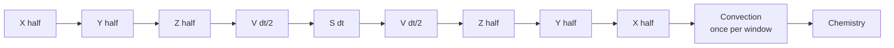
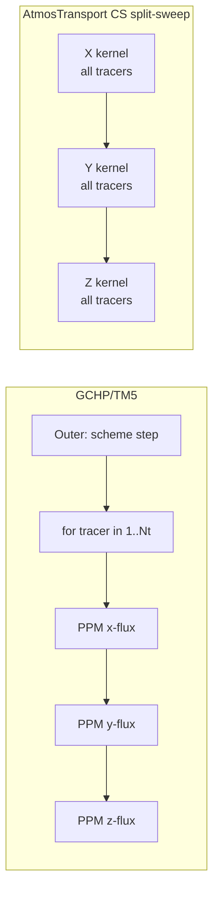

```@meta
CurrentModule = AtmosTransport
```

# Operators on top of the binary

With the daily binary mmap'd and a typed `state.air_mass` on the same
basis, every physics operator becomes a small `apply!(state, ...,
op, dt)` call. This page maps the five operator families
(advection, diffusion, convection, surface flux, chemistry) onto the vocabulary
TM5 and GCHP users already have.

If you have only read the [Binary pipeline](binary_pipeline.md) page,
the relevant takeaway is that at *every* substep the runtime has on
hand:

- `m` — air mass per cell on the binary's basis (dry by default),
- `am`, `bm` — horizontal mass fluxes through x- and y-faces (or
  `hflux` on RG),
- `cm` — vertical mass flux at level interfaces (closed against
  `dm` at write time),
- `ps` — surface pressure per cell,
- optionally paired `qv_start`/`qv_end` endpoints, `cmfmc`/`dtrain`,
  or the four TM5 fields.

Operators consume these directly; no operator builds a flux field
from raw winds at run time.

## Transport composition

Each transport substep uses a directional advection palindrome with a
policy-selected center. Convection and chemistry are separate window-cadence
blocks:

```
transport shell:  X → Y → Z → CENTER → Z → Y → X
default CENTER:   V(dt/2) → S(dt) → V(dt/2)
LL/CS alternate:  S(dt) → V(dt)
convection: apply!(state, convection_forcing, grid, convection, dt)
chemistry:  apply!(state, meteo, grid, chemistry, dt)
```

Where:

- `X`, `Y`, `Z` are half-step directional sweeps,
- `V` is vertical diffusion (the Thomas implicit solve),
- `S` is the surface flux deposition,
- the default midpoint center is the time-symmetric Strang composition,
- the `surface_flux_boundary = true` LL/CS center is GCHP-style
  source-before-full-solve ordering and is not a symmetric Strang split.

For binary-scheduled drivers the full `step!` is bypassed; the
runtime brackets the window's `transport_step!` substeps with exact
constant-rate exponential-decay half-steps, then runs convection and any
unsplit chemistry (including time-varying-rate decay) at the window end. The convection placement is GCHP-style, and is
*different from TM5's `xyzvvzyx` interleaving* — TM5 runs convection
inside the vertical-only legs. See the philosophy page for the
rationale.



## Advection

### Scheme selection by type

`AbstractAdvectionScheme` has four production subtypes:

| Scheme | What TM5/GCHP user it maps to | Grids | Multi-tracer fusion |
| --- | --- | --- | --- |
| `UpwindScheme` | First-order upwind (debugging only) | LL, RG, CS | yes |
| `SlopesScheme` | TM5's Russell–Lerner face flux, but with van Leer slopes re-diagnosed every sweep instead of TM5's prognostic moments | LL, CS | yes |
| `PPMScheme` | PPM with Colella-Woodward monotonicity (GCHP PPM-NV5) | LL, CS split-sweep | yes |
| `LinRoodPPMScheme{ORD}` (ORD ∈ {5,7}) | FV3 Lin-Rood PPM (GCHP dynamics) | CS only | **no** (per-tracer loop) |

Reduced Gaussian currently supports `UpwindScheme` only; requesting a
higher-order scheme on RG is rejected before transport begins.

!!! note "No TM5 slopes advection"
    TM5 carries the tracer-mass slopes `rxm`, `rym`, `rzm` as prognostic
    state. `SlopesScheme` has no moment state: it shares TM5's face flux but
    is markedly more diffusive. No option reproduces TM5's advection; see
    [Advection schemes](@ref) for the measured differences.

The TOML `[advection].scheme` key parses to a Julia type at config
time; the runtime sees the typed value and dispatches at compile
time. *There is no runtime branch on the scheme name.* Subtyping is
the extension mechanism.

### Palindrome subcycling and the positivity budget

The Strang split is a six-leg palindrome, `X → Y → Z → midpoint → Z → Y → X`
(`H → V → midpoint → V → H` on reduced Gaussian). Every leg moves one stored
substep flux, so each direction is applied twice per transport step. A cell's
outflow over one palindrome is therefore bounded by the *palindrome positivity
budget*

```
ratio = 2 · (out_x + out_y + out_z) / min(m_start, m_end)
m_end = m_start + 2 · (in_x + in_y + in_z − out_x − out_y − out_z)
```

with `out_d = max(0,-a_lo) + max(0,a_hi)` (the Lin-Rood 1996
refinement, not `max(|a_lo|, |a_hi|)`) and `in_d − out_d = a_lo − a_hi`;
`m_end` is the cell's mass after the palindrome. The preprocessor's
positivity gate uses the same budget against `min(m, m_next)` with the
window's end mass `m_next`, for cubed-sphere and lat-lon binaries alike. For binaries written
with adaptive substeps, the preprocessor bakes the verified count into
`steps_per_window_by_window[k]`. The binary-scheduled runtime executes exactly
that many transport substeps and fixes the inner subcycle count at
one; it neither re-pilots nor refines the stored schedule.

Without a binary schedule (lat-lon and reduced-Gaussian binaries, direct calls
of the Strang functions) the runtime picks one subcycle count for the whole
step, `n = ceil(ratio / cfl_limit)` with `cfl_limit = 0.95`
(`DEFAULT_CFL_LIMIT`) on every topology, and runs the symmetric composition

```
(X → Y → Z)^n → midpoint operators → (Z → Y → X)^n,    every flux divided by n
```

with the midpoint (diffusion, surface flux) applied once. At `n = 1` this is
the palindrome above. The reverse half is the adjoint of the forward half, so
the composition stays symmetric and keeps second-order splitting with the
same `6n` sweeps; FV3's `fv_tracer2d` likewise repeats its whole 2-D operator
`nsplt` times at flux / `nsplt`.

What the runtime count guarantees: the midpoint does not change air mass and
every `X Y Z` (or `Z Y X`) block changes a cell's mass by the same amount, so
the masses between blocks lie between `m_start` and `m_end`; one block removes
at most `(cfl_limit / 2) · min(m_start, m_end)`. Hence every pass removes at
most `cfl_limit / 2` (47.5%) of the mass the cell holds when the pass starts,
and air mass stays positive through the whole step. A cell with outflow and
`min(m_start, m_end) ≤ 0` is an invalid flux set and the count throws an
`ArgumentError`. Budgeting against `m_start` alone (the earlier rule) fails in
cells that drain within the step: their later blocks start well below
`m_start` (`test/core/test_subcycle_composition.jl` has such a cell, where
that rule drove air mass negative). Subcycling each
direction separately (`X^n Y^n Z^n | Z^n Y^n X^n`, the order of 0.5.0 and earlier)
does not have this property: the `n` passes of one leg together remove the
full-flux outflow of that direction before another direction can refill the
cell, so in non-divergent flows the air mass went negative and uniform tracers
were lost (issue #61). TM5 keeps per-direction loops but steps the mass through
them and shortens the whole step when a loop would fail
(`advectm_cfl.F90`, `Check_CFL`).

### Multi-tracer fusion

For `SlopesScheme` and `PPMScheme` on the CS split-sweep path, each
direction's sweep packs **all tracers into a single kernel** —
`_cs_xsweep_mt_kernel!`, `_cs_ysweep_mt_kernel!`,
`_cs_zsweep_mt_kernel!`. The palindrome launches six kernels total
regardless of tracer count (one per leg of `X → Y → Z → Z → Y → X`).
On GCHP / TM5 the tracer loop is *inside* the PPM call; you launch
`6 · Nt` kernels per palindrome. For `Nt = 50` this is the
difference between 6 and 300 launches per palindrome.



The `LinRoodPPMScheme` path on CS does *not* fuse and runs the
per-tracer loop. This is a known asymmetry — the Lin-Rood
horizontal step is structurally per-tracer and the multi-tracer
fusion would require restructuring `fv_tp_2d_cs!` to loop tracers
inside the update kernel.

### Adaptive substeps

```mermaid
flowchart TD
    A[Window k starts] --> B[Read binary substep count<br/>steps_per_window_by_window[k]]
    B --> C[Fix inner directional<br/>subcycle count to 1]
    C --> D[Run one palindrome substep]
    D --> E[Advance substep counter]
    E --> F{Stored substeps done?}
    F -->|no| D
    F -->|yes| G[Window k complete]
```

The positivity budget is a write-time preprocessing gate. A v4 runtime trusts
that verified contract and does not alter the schedule; a failing product must
be regenerated with a safer preprocessing schedule.

## Diffusion

`ImplicitVerticalDiffusion` is the production diffusion operator. It
runs the standard tri-diagonal Thomas solve column-by-column. The
diffusivity profile is supplied by an `AbstractKzField`:

| Kz field | Source | Status |
| --- | --- | --- |
| `ProfileKzField` | Static profile from TOML | Production |
| `DerivedKzField` | Beljaars–Viterbo local Kz from `(ps, u, v, T, q, z0)` | Production |
| `WindowPBLKzField` | PBL-aware variant of Beljaars–Viterbo | Production |
| `LocalHoltslagBovilleKzField` | GEOS/VDIFF local Holtslag–Boville Kz | Supported when the v4 binary carries all VDIFF fields |
| `GCHPNonlocalPBLField` | GEOS-Chem VDIFF: Holtslag–Boville Kz with the non-local counter-gradient term (`kind = "geoschem_nonlocal_vdiff"`) | Cubed sphere; needs the VDIFF fields and `:pbl_eflux` |

For TM5 users: `DerivedKzField` is the closest analogue to the
Holtslag–Boville-with-Beljaars-correction profile TM5 ships with.
For GCHP users: `GCHPNonlocalPBLField` ports GEOS-Chem's `vdiff_mod.F90`,
including the counter-gradient transport of fresh emissions.
`LocalHoltslagBovilleKzField` uses the local Kz only, without the
counter-gradient term.

### [GEOS-Chem non-local VDIFF: emission profile and the `qmincg` fallback](@id gchp-vdiff-qmincg)

GEOS-Chem's VDIFF moves fresh surface emissions up through the boundary layer
with the counter-gradient flux `ρ K γ`, where `γ = cgs F / ρ_s` is linear in
the surface flux `F`. `GCHPNonlocalPBLField` turns it into a per-step emission
profile. Layers are numbered `k = 1 … N` from the top, `N` the surface layer.
Let `w_{k+1/2}` be the fraction of the step's emission that crosses the
interface below layer `k` upward:

```math
w_{N+1/2} = 1 \ \text{(the ground: the whole emission enters the column)}, \qquad
w_{k+1/2} = \frac{\rho\, K\, \mathrm{cgs}}{\rho_s} \ \text{for } k < N
\ \text{(the counter-gradient flux)},
```

and `w_{1/2} = 0` at the model top. Layer `k` keeps

```math
f_k = w_{k+1/2} - w_{k-1/2}, \qquad \sum_k f_k = 1 .
```

The interior `w` is nonzero only at interfaces among GEOS-Chem's bottom
`npbl` layers (those with reference pressure above 400 hPa) whose lower layer
has its midpoint below the PBL height `h`, as in GEOS-Chem; the highest such
interface can lie just above `h`. It is zero in stable columns and where the
interface lies in the surface layer of the PBL (`z < 0.1 h`). It can grow
with height, so some `f_k` are negative. Of a column's emission `x` in
one step, `ProfileDeposit` adds `x f_k` to layer `k`. Its counter-gradient
part, relative to a surface-only deposit, is

```math
c_k = x\,(f_k - \delta_{kN}) .
```

GEOS-Chem (`vdiff_mod.F90`, GEOS-Chem 14.7.0) forms `q_k + c_k` in its
bottom `npbl` layers from the tracer `q_k` before the step's emission. If any
of these values is below `qmincg = 0`, it drops the counter-gradient term in
that column, and the emission enters only the bottom layer. Its comment gives
the reason: a negative value means the quasi-equilibrium assumed by the
counter-gradient term is strongly violated. AtmosTransport keeps the whole
emission in the surface layer when

```math
\exists\, k:\quad c_k < 0 \quad\text{and}\quad q_k + c_k < 0 ,
```

that is, when the redistribution would make a layer negative or a negative
layer more negative. Every nonzero `c_k` lies in the bottom `npbl` layers,
so the test covers GEOS-Chem's range. It differs from GEOS-Chem only for a
layer that was negative before the step and that the redistribution does not
lower: GEOS-Chem falls back there, AtmosTransport keeps the profile.
Transport leaves roundoff negatives, as small as `-3e-316`, in tracers with a
zero background such as Rn-222 and fossil CO₂. Until OF-108 the test was
`q_k + c_k < 0` on every layer. In the first 2 h of the C90 MERRA-2 golden
day, it kept 94 % of these tracers' column deposits in the surface layer
because of a negative layer the profile does not touch, and the choice
flipped with the sign of roundoff. Both placements add exactly `x` to the
column.

### Surface-flux and diffusion ordering

The diffusion operator pairs with a surface-flux operator through a typed
composition policy:

- `SplitSurfaceFluxCoupling` — two half diffusion steps bracket the surface
  source: `V(dt/2) → S(dt) → V(dt/2)`.
- `DiffusiveSurfaceFluxBoundary` — surface mass is injected first and then
  participates in one full implicit solve: `S(dt) → V(dt)`.

Despite its historical name, `DiffusiveSurfaceFluxBoundary` is an ordering
policy, not a distinct lower-boundary discretization. With fixed linear
diffusion coefficients, injecting the source before the implicit solve gives
`(I - dt*L) * rm_new = rm_old + dt*source`. This is algebraically equivalent
to adding that source to the backward-Euler right-hand side, including a
bottom-layer surface source; the equivalence does not require small `dt`.
Matching that placement alone does not establish full GCHP VDIFF parity.
On lat-lon and cubed-sphere grids, use
`surface_flux_boundary = true` for the supported GCHP-style placement.
Reduced-Gaussian transport currently supports the midpoint split only and
rejects that setting. Treat exact discrete VDIFF parity as unvalidated
until the full-model comparison listed in [Validation status](@ref) exists.

## Convection

Three production operators today:

### `TM5Convection`

Consumes the four TM5 fields from the binary (`:entu`, `:detu`,
`:entd`, `:detd`) and runs the TM5 column solve via a four-band
implicit operator. This is the path for ERA5-driven runs. The
algorithm follows `tm5/levitation.F90` closely; the column solve is
in `src/Operators/Convection/tm5_column_solve.jl` and the kernels
in `tm5_kernels.jl`.

#### [Level merging (`n_merge > 1`)](@id tm5-level-merging)

`n_merge > 1` is an AtmosTransport approximation for the collaborative GPU
solver; TM5 merges levels once, in its met preprocessing, and never
reconstructs a fine profile. Each group `s` of `n_merge` adjacent fine layers
`k` (tracer mass `r_k`, air mass `m_k`) becomes one super-layer:

```math
R_s = \sum_{k \in s} r_k, \qquad M_s = \sum_{k \in s} m_k, \qquad
F_s = \sum_{k \in s} F_k \quad (F = \mathrm{entu}, \mathrm{detu}, \mathrm{entd}, \mathrm{detd}).
```

The backward-Euler solve `C R' = R` on the super grid gives `R'_s`. Its matrix
has unit column sums and a non-negative inverse, so it conserves mass and is
monotone. Each fine layer then receives a share of its super-layer's change:

```math
r'_k = r_k + (R'_s - R_s)\, w_k, \qquad
w_k = \frac{|r_k|}{\sum_{j \in s} |r_j|}.
```

If all of a super-layer's fine values are zero, the weights are
``w_k = m_k / M_s`` (uniform mixing ratio), and `1/n_merge` if ``M_s = 0`` as
well.

- The weights lie in ``[0, 1]`` and sum to one, so ``\sum_{k \in s} r'_k = R'_s``:
  the column total is conserved, and a uniform mixing ratio ``r_k = c\, m_k``
  (for which ``w_k = m_k / M_s`` and the solve returns ``R'_s = R_s`` up to
  rounding) is kept.
- Columns without convection, and super-layers above the solved cloud window,
  have ``R'_s = R_s`` and keep their values bit for bit.
- No cell changes by more than ``|R'_s - R_s|``.
- If a super-layer's fine values share one sign, ``r'_k = R'_s\, (r_k / R_s)``:
  the fine profile is scaled. The code evaluates this form for such
  super-layers, so non-negative tracers stay non-negative in floating point
  too, as with the unmerged solve.
- Only super-layers holding values of both signs can increase the column's
  ``\sum_k |r_k|``:
  ``\sum_k |r'_k| - \sum_k |r_k| \le 2 \sum_{s\ \mathrm{mixed}} |R'_s - R_s|``.
  Without them the column's ``\sum_k |r_k|`` does not grow, as for the solve
  itself.

Before OF-107 the split was ``r'_k = R'_s\, r_k / R_s``. Its weights are
unbounded when a super-layer holds near-cancelling values of both signs, which
small advection undershoots and negative emission cells provide. On the C90
golden columns, one hourly step grew a column's ``\sum_k |r_k|`` up to 84-fold.
The air-mass-weighted increment ``w_k = m_k / M_s`` is linear in the tracer but
not monotone. On the same columns it turned non-negative Rn-222 and fossil
CO₂ into up to 35,000 negative cells per hourly step (down to −7 % of the
field maximum), so it was not adopted. Merged solves have no adjoint: CS
footprints require `n_merge = 1`.

Known limitations of the split (use `n_merge = 1` where they matter):

- It is not additive in the tracer: it scales with the tracer and flips with
  its sign, but the split of a sum is not the sum of the splits. Tagged-tracer
  budgets (components that must add up to a total tracer) and runs that rely
  on linearity, such as anomaly or interannual-variability transport, are
  therefore not exact with `n_merge > 1`.
- A super-layer that is nearly empty but of one sign hands almost all of its
  convective gain to the fine layer holding the trace amount (for example a
  pair holding 1e-25 and 1e-22 kg). This stays conservative and bounded — the
  mixing ratio within the pair can differ by up to about a factor `n_merge` —
  and the pre-OF-107 split behaved the same way.

### `CMFMCConvection`

Consumes `:cmfmc` (and optionally `:dtrain`) from the binary and
runs the GCHP-style upwind moist convection scheme. This is the
path for GEOS-driven runs. The CFL substep is chosen at met-window
start from the maximum cell-relative mass flux.

### `CMFMCMatrixConvection`

Consumes `:cmfmc` and `:dtrain`, derives TM5-style entrainment and detrainment
rates, and delegates to the implicit `TM5Convection` column solve. This offers
the GEOS forcing contract with matrix-solve numerics on LL, RG, and CS.

### Placement note (important for TM5 users)

We place convection **after** the FV transport block — once per met
window, between the palindrome's last `X` sweep and chemistry. TM5
interleaves convection inside the palindrome's vertical legs
(`xyzvvzyx` → convection inside the `vv`). The GCHP placement is
faithful to the corresponding GCHP CTM placement in `gchp_chunk_mod.F90`; the
TM5 placement is faithful to TM5-4DVAR's documented order.

For research questions where convective tracer transport in the
column matters (`222Rn` profiles, deep-convective venting), the
placement matters; we have a follow-up plan to support both
placements via a `[run].convection_placement` setting.

## Surface flux

`SurfaceFluxOperator` carries a `PerTracerFluxMap` — a typed mapping
from tracer name to an `AbstractSurfaceFluxSource`. Each source
supplies its surface flux as **kg/s per cell, already
area-integrated**.

For TM5/GCHP users this means:

- EDGAR/GFED/HEMCO `kg/m²/s` raster needs an explicit
  multiplication by cell area at TOML-build time. This is the
  preprocessor's job, not the runtime's.
- The runtime adds the flux mass to the bottom cell (`k = Nz`) at
  the surface step. With `DiffusiveSurfaceFluxBoundary` the
  diffusion solve then redistributes that mass upward.

```@example
# Conceptual layout of the per-tracer flux map (do not actually run)
# Each source struct knows how to read its data and inject into
# the appropriate tracer at apply! time.
```

## Composition rules and apply! contract

Every operator has the same `apply!` shape:

| Family | Signature |
| --- | --- |
| Advection | `apply!(state, fluxes, grid, scheme, dt; workspace, cfl_limit, diffusion_op, emissions_op, meteo)` |
| Diffusion | `apply!(state, meteo, grid, op::AbstractDiffusion, dt; workspace)` |
| Convection | `apply!(state, forcing::ConvectionForcing, grid, op::AbstractConvection, dt; workspace)` |
| SurfaceFlux | `apply!(state, sources::PerTracerFluxMap, grid, op::AbstractSurfaceFluxOperator, dt; workspace)` |

The second positional argument carries the time-resolved data the
operator needs from the binary. Workspaces are pre-allocated
parametric structs that own the scratch buffers and the per-backend
kernel objects.

## What's not yet a typed operator

A small list of known gaps you may run into if you are porting a TM5
or GCHP workflow:

- **Wet deposition** is not yet an operator family. Aerosol /
  scavenging users will need to add an `AbstractWetDeposition`.
- **Dry deposition** lives inside the surface flux operator today;
  it does not have its own resistance-based abstraction. GCHP-style
  deposition users will want a separate `AbstractDryDeposition`.
- **Photolysis / fast chemistry** is out of scope. Only first-order
  decay (`ExponentialDecay`) is shipped; this is enough for
  `222Rn → 222Pb` and similar half-life tracers.

The current validation boundary is summarized in
[Validation status](../theory/validation_status.md).

## Reading next

- For the sensitivity side (adjoint of every operator above), see
  [Adjoints on top of the binary](adjoints.md).
- For how the multi-tracer kernels actually launch on CPU, CUDA, and
  Metal from a single source, see
  [Kernel architecture](kernel_architecture.md).
- For the deep-physics treatment (palindrome derivation, monotonicity, and
  signed-tracer boundedness tradeoffs), see
  [Advection schemes](../theory/advection_schemes.md).
